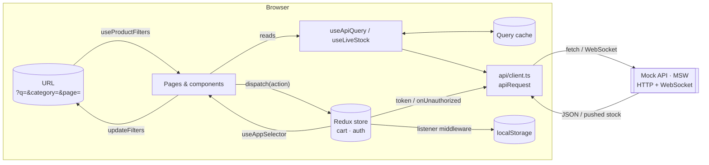

# Architecture

The Bug Bazaar is a single-page React 19 + TypeScript app built with Vite. It runs entirely in the browser: a mock backend (MSW) answers HTTP and WebSocket requests, so the app's code is the same as it would be against a real server.

## Folder structure

```
src/
  main.tsx              Entry: installs global error handlers, starts the MSW worker, then renders <App/>
  App.tsx               Root error boundary → Redux <Provider> → <RouterProvider> (+ Dev panel)
  router.tsx            Every route in one place; protected routes nest under <ProtectedRoute>

  api/                  DATA LAYER: the only code that talks to the network
    client.ts           apiRequest(): base URL, JSON, auth header, AbortSignal, → ApiRequestError
    products.ts auth.ts orders.ts   One typed function per endpoint
    errors.ts           toUserError(): ApiRequestError → typed, user-friendly UserError
    cache.ts            In-memory GET cache (fresh / stale / invalidate)
    liveStock.ts        WebSocket client with reconnect + backoff

  hooks/                Reusable logic, no UI
    useApiQuery.ts      Loading/error/success + abort + cache (server state)
    useLiveStock.ts     Subscribes visible products to live stock
    useDebouncedValue.ts useScrolledPast.ts useLocalStorage.ts useDocumentTitle.ts useElementGeometry.ts

  store/                CLIENT STATE (Redux Toolkit)
    store.ts            configureStore + plugs token/401 handling into the data layer
    cartSlice.ts authSlice.ts       State + the only allowed updates (actions)
    selectors.ts        Derived values (cart count, total) with createSelector
    persistence.ts      Listener middleware: saves cart + session to localStorage
    hooks.ts            Typed useAppSelector / useAppDispatch

  features/             One folder per feature: its pages and the components only it uses
    products/           List (filters ⇄ URL, pagination, virtual grid), details, cards
    cart/ checkout/ orders/ auth/ account/

  components/           Shared UI: Layout, loading/empty/error views, error boundaries, Back to Top
  monitoring/           logError() (one reporting seam) and the render profiler hook
  types/                api.ts (the contract), request.ts (RequestState union)
  utils/                Pure helpers: formatPrice, assetUrl
  mocks/                Fake backend: seed data, DB, HTTP handlers, WebSocket server, Dev panel
  test/                 Vitest setup and the Node MSW server
```

**Dependency rule:** arrows only point downward. `features → hooks/store → api → (network)`. Components never import from `api/client.ts` or call `fetch`/`WebSocket` directly; an ESLint rule enforces this. `api/` never imports the store; the store _injects_ the token getter and 401 handler instead (`configureApiAuth`), which avoids a circular import.

## Data flow



**Example 1: searching for "duck".**

1. You type in the search box. `useDebouncedValue` waits 300 ms.
2. `updateFilters({ q: 'duck' })` writes `?q=duck` to the URL.
3. `ProductListPage` re-renders. `parseFilters(URL)` gives the new filters, and `useApiQuery('products?search=duck…', fetchProducts)` runs:
   - It checks the cache (fresh → no request).
   - Otherwise it aborts the previous request and calls `apiRequest`, which `fetch`es through MSW.
4. You get a `RequestState`: `loading` → skeleton, `error` → `ApiErrorView` with Retry, `success` → `ProductGrid`.
5. `ProductGrid` subscribes its 24 product ids to live stock, and pushed updates re-render only the changed card (`memo`).

**Example 2: placing an order.**

1. `CheckoutPage` reads the cart from Redux and gets an idempotency key for this cart's contents.
2. It calls `createOrder()`, which sends `POST /api/orders` with an `Idempotency-Key` header.
3. On `201`, it navigates to `/orders/:id`, dispatches `cartCleared()` (the persistence middleware updates localStorage), and invalidates the product cache.
4. On `409`, it re-fetches stock and dispatches `stockUpdated`, then shows a message naming the item.
5. On `401`, the client calls `onUnauthorized` → `sessionExpired()` → `ProtectedRoute` redirects to login and returns here afterwards.

## Where each kind of state lives

| Kind                         | Examples                                                    | Where                                                           | Why there                                                                                     |
| ---------------------------- | ----------------------------------------------------------- | --------------------------------------------------------------- | --------------------------------------------------------------------------------------------- |
| **URL state**                | search text, category, in-stock, sort, page, view           | The query string, read and written by `useProductFilters`       | Must survive refresh, be shareable as a link, and work with Back/Forward                      |
| **Server state**             | products, a product, `me`, an order                         | `useApiQuery` + `queryCache` (and `useOrderStatus` polling)     | The server owns it; we keep a _cached copy_ that can go stale and is refetched or invalidated |
| **Live server state**        | stock pushed over the WebSocket                             | `useLiveStock` (per grid / page); cart lines via `stockUpdated` | Short-lived overlay on top of the cached data                                                 |
| **Global client state**      | cart lines, session (token, user)                           | Redux Toolkit store, persisted to `localStorage`                | Shared across many pages; changes only through defined actions; survives reload               |
| **Local UI state**           | search box text, quantity picker, "submitting", form errors | `useState` / `useRef` in the component                          | Only that component cares                                                                     |
| **Per-tab checkout attempt** | idempotency key + cart signature                            | `sessionStorage`                                                | Must survive a reload mid-checkout, but not leak into other tabs                              |

## The choice I'd defend: server state is not Redux state

Products live in a cache behind `useApiQuery`, **not** in Redux, even though Redux is already in the app.

- **Why:** server data has different problems from client data:
  - **Staleness:** when do we refetch?
  - **Deduping:** don't fetch what we already have.
  - **Cancellation:** abort what's no longer needed.
  - **Invalidation:** after an order, stock changed.

  Putting products in Redux would mean hand-writing all of that inside reducers and thunks, mixed in with cart logic. Keeping them separate makes each simpler: Redux only holds things _we_ own (cart, session), and the query layer handles things the _server_ owns.

- **The cost:** two state systems to understand instead of one, and our hand-rolled cache is simpler than a library (no request deduping across components, no garbage collection by time).
- **How it could change:** pages only talk to `useApiQuery`, so replacing its internals with RTK Query (which keeps server state in Redux, _done properly_) wouldn't touch a single page.

## Design patterns used

### 1. Container and presentational components

- **Where:** `ProductListPage` (container: reads URL filters, fetches, decides which state to show) → `ProductGrid` → `ProductCard` / `StockBadge` (presentational: props in, markup out). The same split exists between `ProductDetailsPage` (container) and `AddToCart` / `StockBadge`.
- **Why:** presentational components are easy to reuse (`ProductCard` is used by both the paged and the virtual grid) and easy to optimize (`memo` works because the card has only plain props). Data fetching and routing logic stay in one place per page.

### 2. Custom hooks (logic reuse)

- **Where:** `useApiQuery`, `useLiveStock`, `useDebouncedValue`, `useScrolledPast`, `useLocalStorage`, `useProductFilters`, `useOrderStatus`, `useDocumentTitle`.
- **Why:** they share _behavior_ (abort on change, timers, listeners, persistence) without sharing markup, and each owns its cleanup. `useScrolledPast` removed two copies of the same scroll listener (Back to Top and the header shadow). `useApiQuery` removed duplicated loading/error/abort code from three pages (list, details, account).

### 3. Adapter / gateway (the data layer)

- **Where:** `src/api/`. `apiRequest()` adapts `fetch`'s awkward behavior into one clean interface:
  - `fetch` only rejects on network errors, so we check `response.ok` ourselves.
  - Error responses come in different shapes, and we normalize them into one `ApiRequestError`.
  - Bodies can be empty or non-JSON.

  `toUserError()` then adapts _that_ into UI language.

- **Why:** the rest of the app depends on our interface, not on `fetch` or the backend's quirks. Switching to axios, adding retries, or pointing at a real backend changes files in `src/api/` only.

**Also used:**

- **Observer:** Redux subscriptions, the WebSocket, and the listener middleware.
- **Dependency injection:** `configureApiAuth({ getToken, onUnauthorized })`.
- **Discriminated unions as a state machine:** `RequestState`, `UserError`.
