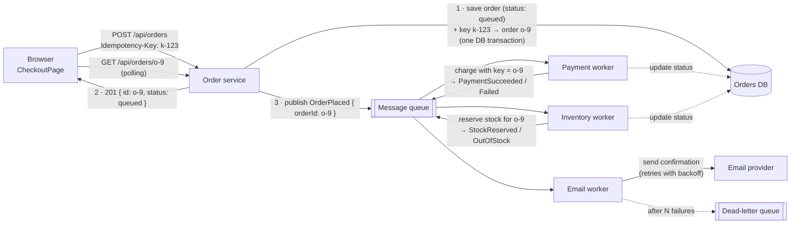

# Order flow: an order service with a queue and workers

Today the mock API creates an order and moves it `queued → processing → confirmed` on a timer. This document designs how a real backend would do it.

## Diagram

**Step by step:**

1. The browser sends the order with an **Idempotency-Key** (generated per checkout attempt; see D3-2).
2. The **order service** validates the order, checks stock, and in **one database transaction** saves the order as `queued` _and_ records `key → order id`. It answers **201 immediately**, without waiting for payment or email.
3. It publishes an `OrderPlaced` event to the **queue**. To avoid "saved but never published", use the **outbox pattern**: the event is written to an `outbox` table in the same transaction, and a relay publishes it afterwards.
4. **Workers** consume the event independently:
   - The **payment worker** charges the card.
   - The **inventory worker** reserves stock.
   - The **email worker** sends the confirmation.

   Each reports back, and the order moves `queued → processing → confirmed` (or `failed`).

5. The confirmation page **polls** `GET /api/orders/:id` until the status is final. This is exactly what `useOrderStatus` does against the mock today.

## Why a queue helps

- **Fast, reliable checkout:** the shopper waits for one database write, not for the payment provider, the warehouse system _and_ the email service in a row. One slow dependency no longer makes checkout slow.
- **Failure isolation:** if a worker is down, messages wait in the queue instead of failing the order. The order service doesn't even need to know the workers exist.
- **Retries for free:** queues redeliver a message until a worker acknowledges it, and failed messages are retried with backoff.
- **Scales per job:** a Black Friday spike? Add more payment workers (horizontal scaling) without touching the order service.
- **Easy to extend:** a new "loyalty points" worker just subscribes to `OrderPlaced`.

## What happens if email is down?

Nothing the shopper would notice at checkout:

- The order is already saved and the response already sent. Payment and inventory workers carry on, because email is a separate consumer.
- The email worker's sends fail, so it doesn't acknowledge the message. The queue **retries with exponential backoff** (1 min, 5 min, 30 min…).
- After N failed attempts the message goes to a **dead-letter queue**. An alert fires, someone fixes the email provider, and the dead-lettered messages are replayed.
- The shopper still sees "Confirmed" on the order page, because order status doesn't depend on email. The confirmation email simply arrives late. This is **eventual consistency**: everything ends up correct, just not at the same instant.

## How the D3-2 approach prevents double charges

Double charges can come from two places, and each layer guards one of them.

**1. The client retries the same checkout** (double click, timeout, lost response, page reload):

- **Double click:** the button is disabled and a `useRef` guard blocks a second request while one is in flight.
- **Every other retry:** every attempt carries the **same Idempotency-Key**. The key is tied to the cart's contents and kept in `sessionStorage`, so it survives a reload. The server stores `key → order id` in the same transaction as the order. A repeated key returns the _existing_ order (same `id`), and no new order or `OrderPlaced` event is created.
- **Proven in the mock:** tick "order saved, then 500" in the Dev panel, then click Try again. There's still exactly one order, and `CheckoutPage.test.tsx` asserts it.

**2. The queue delivers the same message twice.** Queues guarantee _at-least-once_ delivery, so a worker can crash after charging but before acknowledging.

- The payment worker calls the payment provider with **its own idempotency key derived from the order id** (`charge:o-9`). Stripe and similar providers return the original charge for a repeated key instead of charging again.
- The worker also records "o-9 paid" and skips messages for orders already paid.

So: **one checkout → one order → one `OrderPlaced` → one charge**, even when every network hop is retried.
